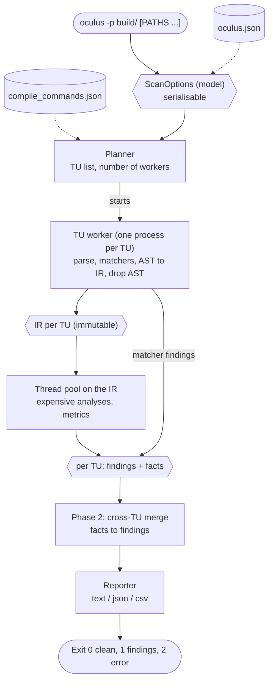
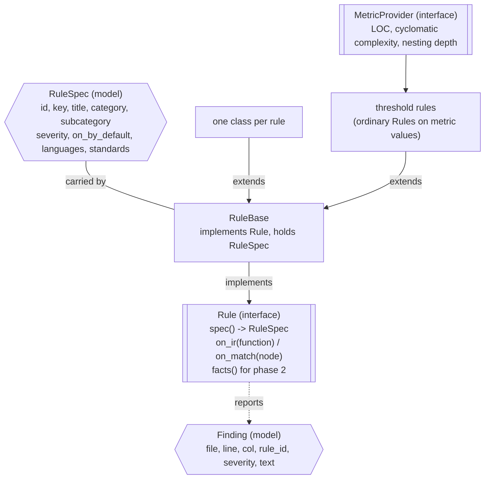

# Oculus: architecture draft (not final)

This is the cleaned-up version of the first rough diagrams (programme structure,
rule model, CLI and configuration, language selection, rule information). It
records what is decided and lists what is still open. Nothing here is final;
`CLAUDE.md` has the short list of decisions.

## 1. Scope

- Languages: C and C++ only. No Python or other languages, no shebang detection.
- Target standard: open (MISRA C:2012, a newer edition, C++).
- Name: Oculus only. Binary `oculus`, config file `oculus.json`. The working name
  "rulescan" is gone.

## 2. Frontend

Clang is the frontend. **How Oculus binds to Clang is not decided.** The three
options:

| Option | What it sees | Speed | Stability across LLVM versions |
|---|---|---|---|
| Python `clang.cindex` | libclang C API only | slowest: one Python call per cursor | stable |
| libclang C API, called natively (C, C++, or AIML via `extern: "C"`) | libclang C API only | fast | stable |
| LibTooling / AST matchers (C++) | the full Clang AST | fast | changes with every LLVM major |

The libclang C API does not expose the whole AST. Implicit casts, many
expression kinds (they come back as `UnexposedExpr`) and parts of the type
information are missing. Rules about implicit conversions and expression types
need exactly that information. The old `exodus analyze` (now in
`Pymann/coding-rules/legacy-exodus-analyze`) used libclang from Python plus
tree-sitter and ran into these limits.

**Recommendation:** a small C++ worker on LibTooling that does nothing but parse
one TU, run the single-pass matchers and write Oculus' own IR. Everything else
(rules on the IR, metrics, merge, report) works on that IR and can be written in
any language. The LLVM version dependency is then confined to the worker.
If the rest is written in AIML, this also avoids the problem that AIML's FFI
only speaks the C ABI and cannot call the C++ LibTooling API directly.

Implementation language: AIML v2 (the `masterv2` line of `Pymann/aiml`), built
with `aiml build`. The parts are wired by one class group, `ScanRuntime`
(`src/runtime.aiml`, aiml spec/58). The frontend sits behind the `Frontend`
interface; until the binding is decided, `StubFrontend` reads only the source
text, so rules that need no AST (line counts) already run end to end.

## 3. Pipeline



1. **Input.** `compile_commands.json` (`-p DIR`) is the source of the TUs and of
   their flags (includes, defines, `-std`, `-x`). Plain paths without a
   compilation database work only with flags from `oculus.json` and give
   worse results; Oculus warns about that.
2. **Workers.** One process per TU. The number running at once is
   `min(--jobs, free RAM / expected peak per TU)`; `--jobs` is only the upper
   limit. A crash in one TU costs only that TU; Oculus reports it and exits with 2.
3. **Inside a worker.** Parse the TU, run all AST matchers in one pass, convert
   every function to the own IR in that same pass, then drop the AST.
   Clang allocates all AST nodes in one arena per `ASTContext`, so the AST can only
   be dropped as a whole after the conversion, not function by function.
4. **Thread pool.** Expensive analyses (data flow, value ranges) and metrics run
   in a thread pool on the immutable IR. The Clang AST is never touched from
   more than one thread; it is not thread-safe, and after step 3 it no longer
   exists.
5. **Output of a TU.** Findings plus serialisable facts (declarations, definitions,
   calls, external linkage) for phase 2. Rules keep no state across TUs.
6. **Phase 2.** Merges the facts of all TUs and produces the cross-TU findings
   (e.g. one definition per external object).
7. **Report.** Text format, one finding per line:
   `file:line:col: RULE-ID: message`. JSON and CSV carry the same fields plus
   severity.

## 4. Rules and metrics



- There is only `Rule`. No `MisraRule`, no `CertRule`, and no classes or
  identifiers named after MISRA or CERT.
- Metrics are not rules. A `MetricProvider` produces values; a threshold rule
  turns a value above its limit into a finding.
- Line counting is our own code. No cloc, neither linked nor as an external
  program. (Lizard, MIT, may serve as a reference for complexity.)
- The rule logic is language-independent where possible: a nesting-depth or
  complexity rule works on the IR and does not care whether the IR came from C or
  C++. Only the frontend differs.
- The data a rule needs from the IR (the "RuleInformation" idea) is part of the
  IR design; it never holds pointers into the Clang AST.

## 5. Rule identity and catalogue

- **The id is a number** and never changes, not even when a standard is updated
  or a rule moves to another category. Shown as `OC-0042`.
- The catalogue lives in `Pymann/coding-rules`. Each rule has the id plus
  descriptive attributes:

  ```json
  {
    "id": 42,
    "key": "style.naming.no_builtin_shadowing",
    "category": "style",
    "subcategory": "naming",
    "languages": ["c", "c++"],
    "standards": { "c": "99..23", "c++": "17..23" },
    "severity": "warn",
    "on_by_default": true
  }
  ```

- The dotted form (`style.java.18.to.19.1.1not_this_builtin` in the first draft)
  is fine as a readable key, but it must not be the id: as soon as the language
  or the standard range is part of the key, the key changes when the standard
  changes. That is the MISRA renumbering problem again. Language and standard
  range therefore sit in their own fields, and one rule can cover C and C++.
- Mapping to MISRA C / CERT C by number only, kept internal in
  `Pymann/coding-rules`. It is not shipped and not shown in the output. No MISRA
  or CERT rule texts in this repository; every message is our own wording.

## 6. CLI and configuration

```
oculus [-p BUILD_DIR] [PATHS ...]
    --config FILE        default: oculus.json in the project root
    --format text|json|csv
    --threshold info|warn|error
    --jobs N             upper limit, see section 3
    --single-rule ID
```

- One configuration format: JSON (`oculus.json`). No YAML.
- Precedence: CLI over file over default.
- Two different things that the first draft mixed up:
  - **catalogue** (which rules exist, their attributes): `Pymann/coding-rules`,
    built into Oculus;
  - **project configuration** (which rules are on, which severity, thresholds):
    the `rules` list of `oculus.json`, one entry per rule id:

    ```json
    { "rules": [ { "rule": 42, "enabled": false }, { "rule": 7, "severity": "error" } ] }
    ```

- Language per TU: from the compilation database (`-x`, `-std`, `clang` versus
  `clang++`). Fallback by suffix: `.c` is C; `.cc`, `.cpp`, `.cxx` are C++;
  a header takes the language of the TU that includes it. `--lang` overrides.
  The rule set for the TU is then the catalogue filtered by `languages` and
  `standards`. The `PickPool` cascade from the first draft can implement this
  selection (AIML spec 57); shebang and Python are dropped.

## 7. State of the skeleton

Done: CLI (`sys.arg_dump`), `oculus.json`, `compile_commands.json`, the
`ScanRuntime` group, `Rule` and `MetricProvider` interfaces, the registry, one
example rule (OC-0001, file length, its id a placeholder until the catalogue
assigns ids), the line metric, text/JSON/CSV output, exit codes, unit and
end-to-end tests in CI.

Not yet: the Clang frontend, the IR beyond file and function, worker processes
(the planner computes the count, the scanner still runs the units one after
another in one process), the thread pool, phase 2, loading the catalogue from
`Pymann/coding-rules`. An unknown or malformed flag exits with 1 instead of 2,
because `sys.arg_dump` ends the process itself.

## 8. Open

- Clang binding (section 2) and implementation language.
- Target standard.
- IR design, including what rules need from it (RuleInformation).
- Rule interface details: per TU versus per file, how matcher rules and IR rules
  share one interface.
- Format of the phase 2 facts.
